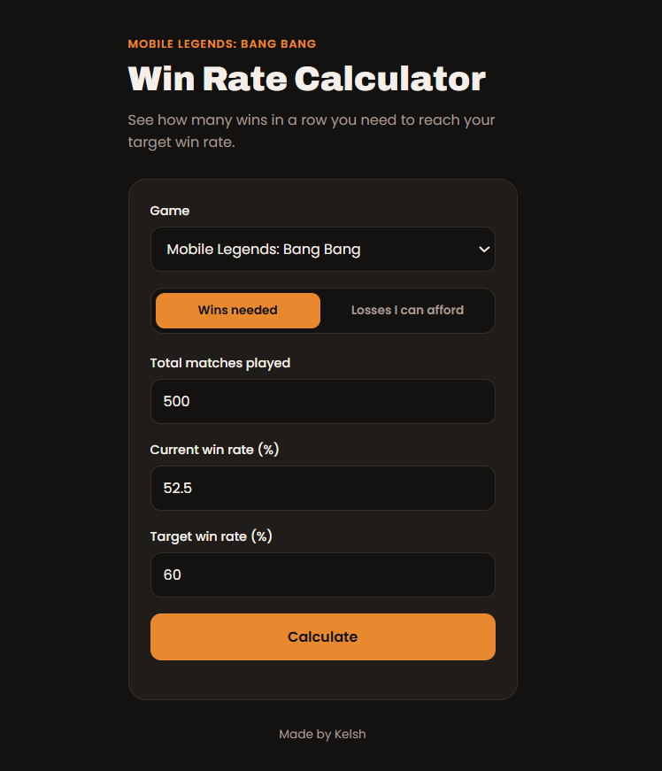

# MLBB Win Rate Calculator

Find out how many wins in a row you need to reach your target win rate, or how many losses you can afford before dropping too low. Built for Mobile Legends: Bang Bang, with support for other games too.

**Live site:** https://kelshrylemaranan.github.io/mlbb-winrate-calculator



## Features

- **Wins needed:** enter your total matches, current win rate and target win rate to see the win streak you need
- **Losses I can afford:** see how many losses in a row you can take before falling under your lowest accepted win rate
- **Progress bar** showing your current win rate against your goal
- **Extra stats** like your final record and new win rate after the streak
- **Clear error messages** for empty fields, negative numbers, a 100% target and more
- **Recent calculations** saved in your browser (last 5)
- **Multiple games:** Mobile Legends, Wild Rift, Valorant, Dota 2 and Honor of Kings
- **Mobile friendly** with automatic dark mode

## How it works

Rates are turned into decimals, then:

```
current wins = total matches x current win rate
wins needed  = (target x total - current wins) / (1 - target)
```

The result is rounded up, because you can't win part of a match.

For losses, your wins stay the same while your total grows:

```
losses allowed = current wins / lowest win rate - total matches
```

That result is rounded down.

## Built with

- HTML
- CSS
- JavaScript (no frameworks)

## Run it locally

1. Clone the repo:
   ```
   git clone https://github.com/KelshRyleMaranan/mlbb-winrate-calculator.git
   ```
2. Open `index.html` in your browser.

No install or build step needed.

## Add another game

Open `script.js` and add one line to the `GAMES` list:

```js
newgame: { name: "Full Game Name", short: "Short", desc: "Game Name" }
```

The dropdown updates by itself.

## Author

Made by [Kelsh](https://github.com/KelshRyleMaranan)